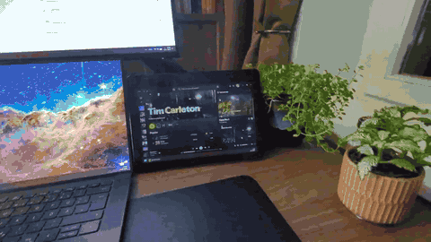

# Echo Show as a second Windows monitor

**"Alexa, open second screen"** turns an Amazon Echo Show into an extra monitor for a Windows PC. It's a real **extended desktop**, not mirroring, and **touch goes back to Windows**.

https://github.com/user-attachments/assets/c93661e0-541c-4ed2-a0f9-a2f4e9cc082f

> A weekend hack, not a product. Tested on my 1280×800 Echo Show and a Windows laptop. Wouldn't recommend it as a gaming display, even though it technically runs on Amazon's *Web API for Games*.

## What it does

- Windows gets a **virtual monitor** (an indirect display driver). You drag windows onto it like onto any other screen.
- A tiny Node.js server captures that monitor with ffmpeg and streams it to the Echo Show.
- You start it by voice through a custom Alexa skill in developer mode. **No Lambda:** your PC is the skill backend, reached through a Cloudflare tunnel.
- **Touch:** tap = click, drag = drag, hold = right click, two fingers = scroll.
- A hidden, muted looping video keeps the Echo from going to sleep.
- **Zero npm dependencies.** Node, ffmpeg, cloudflared and the ASK CLI are all you need.
- No jailbreak, no sideloading, nothing modified on the Echo.



## How it works

```
"Alexa, open second screen"
        │
Alexa cloud ──HTTPS──► Cloudflare tunnel ──► server.js (your PC)
                                               │ replies: Alexa.Presentation.HTML.Start
                                               ▼
Echo Show (Chromium web view) ◄── MJPEG stream ── ffmpeg ddagrab ◄── virtual monitor
        │
        └── touch ──WebSocket──► server.js ──► PowerShell helper ──► Windows mouse
```

## Two versions

Each folder is self-contained. Start with the Silk version, it proves the hard part in ten minutes.

| Folder | What you get | Needs |
|---|---|---|
| [`silk-browser`](silk-browser/README.md) | Extended desktop in the Echo's Silk browser over your LAN | Virtual display driver, ffmpeg 6+, Node 18+ |
| [`web-api-for-games`](web-api-for-games/README.md) | Started by voice ("Alexa, open second screen"), with touch, drag, right click and scroll back to Windows | + cloudflared, ASK CLI, Amazon developer account |
| [`driver`](driver/vdd_settings.xml) | Driver settings with the Echo resolutions | |

## Quick start

1. Install the [Virtual Display Driver](https://github.com/VirtualDrivers/Virtual-Display-Driver/releases) as described in the [Silk version](silk-browser/README.md#one-time-setup), and set the new monitor to *Extend* at 1280×800 (Echo Show 8/10).
2. `winget install Gyan.FFmpeg Cloudflare.cloudflared`, then `npm install -g ask-cli` and `ask configure` (no AWS account needed).
3. Find your virtual monitor:
   ```
   cd web-api-for-games
   node server.js --probe
   ```
4. Start everything (use the adapter and display values from `--probe`):
   ```
   .\start.cmd --adapter 1 --display 0 --target 1280x800 --touch --tunnel --tunnel-protocol http2
   ```
5. Wait for `[skill] Deploy done`, then say **"Alexa, open second screen"** (or on a German Echo: **"Alexa, öffne zweiten Bildschirm"**).

## Turning the virtual monitor on and off

When you don't use the Echo, Windows still has the extra monitor and windows can end up there. Switch it off and on again with:

```
driver\vdd.cmd off
driver\vdd.cmd on
driver\vdd.cmd status
```

It asks for admin rights (UAC) and disables or enables the driver in Device Manager. Windows remembers the monitor's position and resolution.

## Supported devices

| Device | Resolution | Status |
|---|---|---|
| Echo Show 8 / 10 | 1280 × 800 | tested (1280×800 model) |
| Echo Show 5 | 960 × 480 | untested |
| Echo Show 15 / 21 | 1920 × 1080 | untested |

Windows only for now. macOS would need a different virtual display and capture path.

## Limitations

- **Latency and frame rate** are fine for chat, email, dashboards or music controls. Not for games or video.
- The PC has to run the server while you use the screen.
- Free Cloudflare quick tunnels get a new URL on every start, so the server re-deploys the skill each time (about a minute). A named tunnel with your own domain avoids that.
- Alexa web apps end after at most 30 minutes without interaction. Whether the built-in keep-alive extends that is still being tested.
- The skill start occasionally fails with "There was a problem with the requested skill's response". Saying it again usually works.
- No keyboard and no pinch zoom from the Echo.
- Windows running as administrator ignore the touch clicks unless the server also runs as administrator.

## Security

- While the tunnel runs, your screen is reachable from the internet. Every request through the tunnel needs a random key, generated on each start (or fixed with `--key`).
- With `--touch`, anyone with URL **and** key can control your mouse on the virtual monitor. Only use it on your own devices.
- The skill endpoint does not verify Alexa request signatures. That's fine for a private dev skill, but required before publishing.

## Credits

- [Virtual Display Driver](https://github.com/VirtualDrivers/Virtual-Display-Driver) by the VirtualDrivers project
- [FFmpeg](https://ffmpeg.org/) and its `ddagrab` filter
- [Alexa Web API for Games](https://developer.amazon.com/en-US/docs/alexa/web-api-for-games/alexa-games-about.html)

## License

MIT
